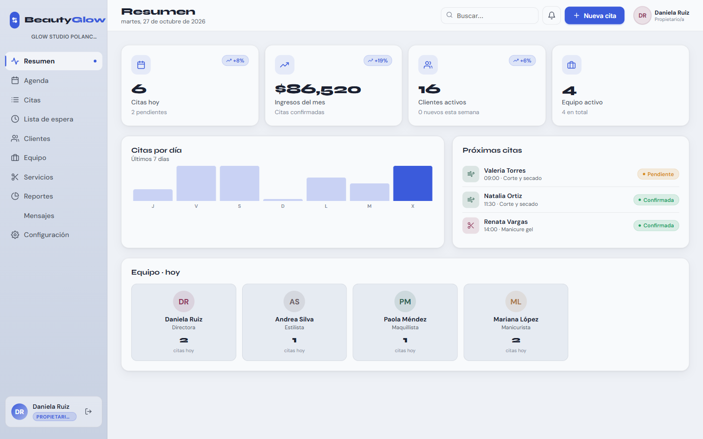
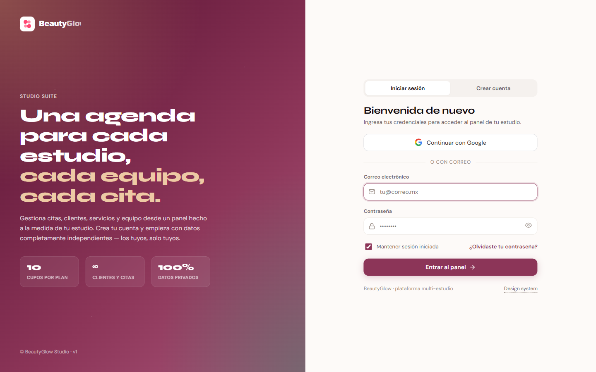
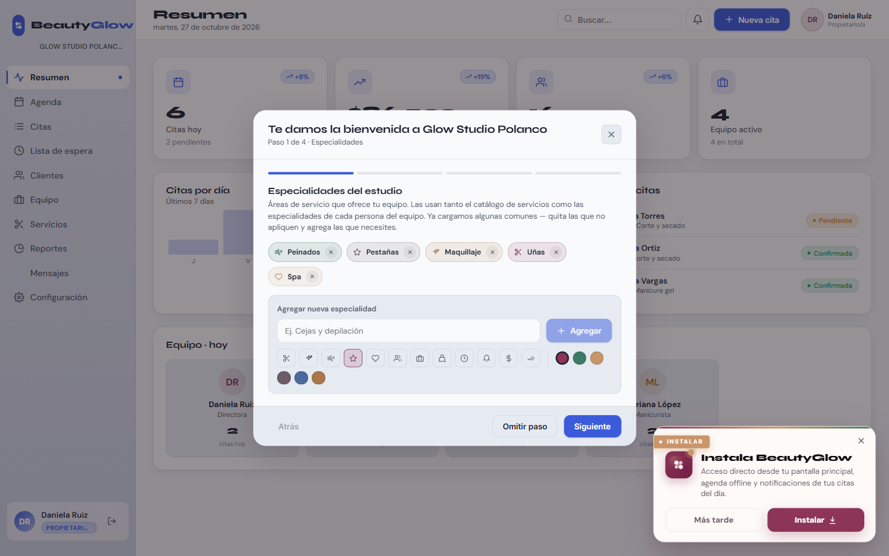
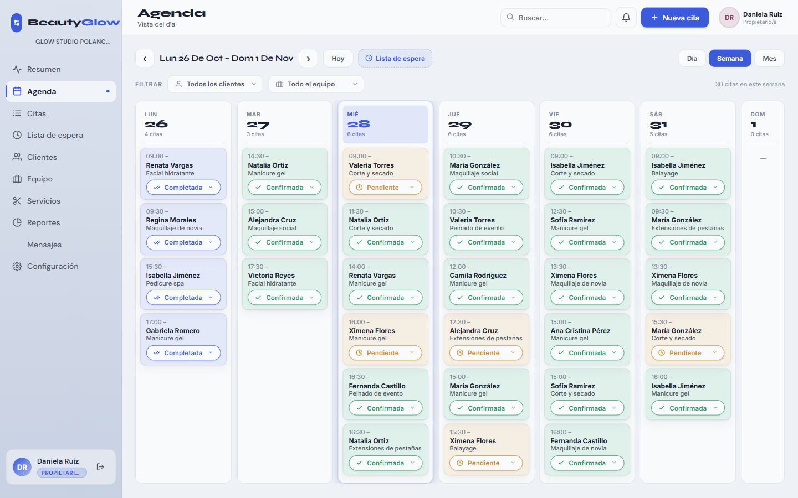
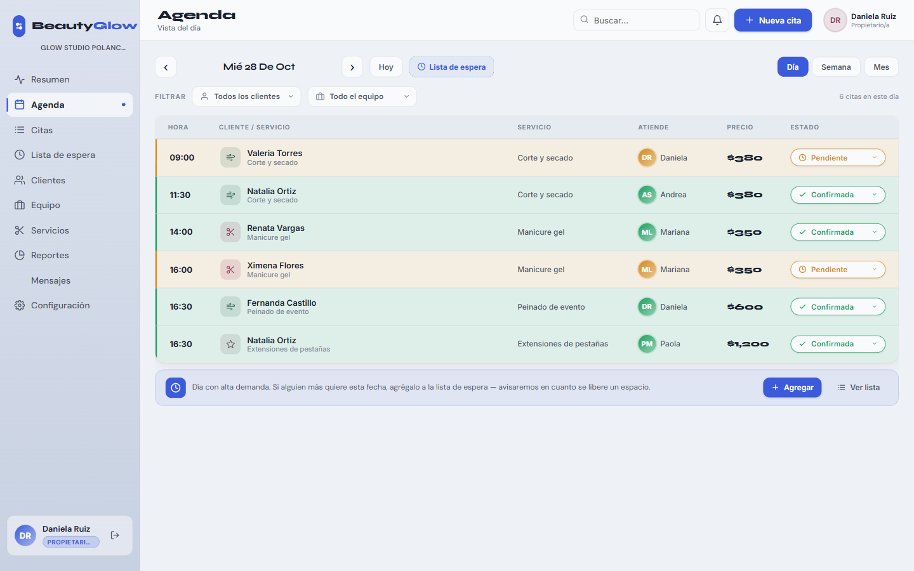
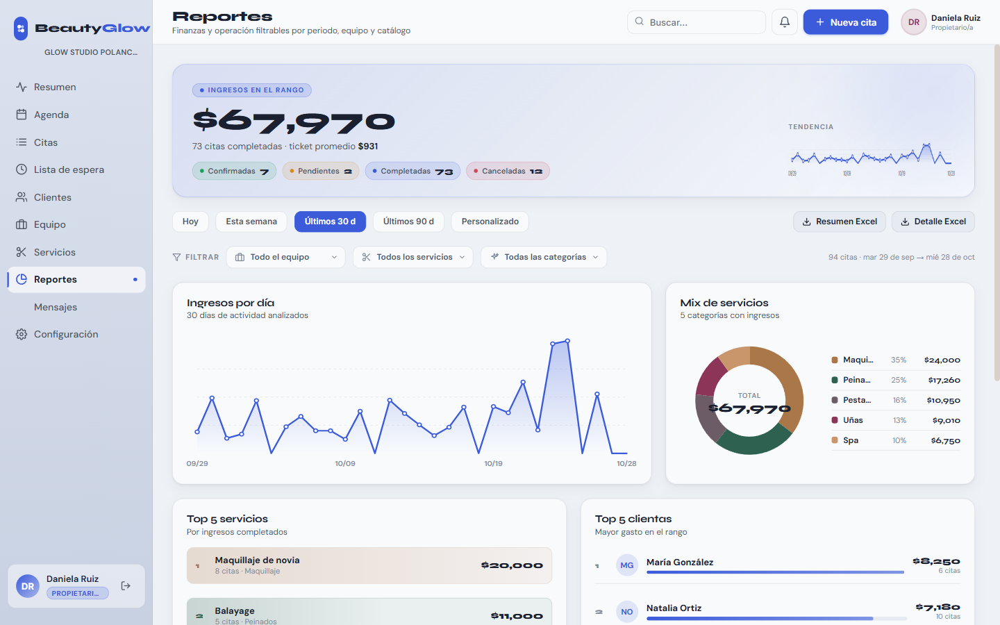
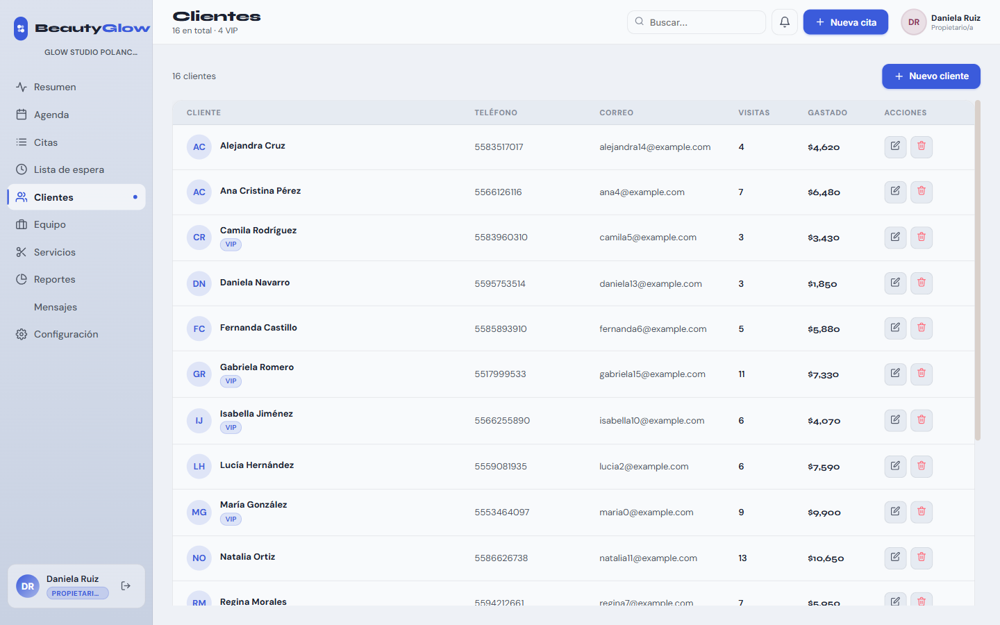
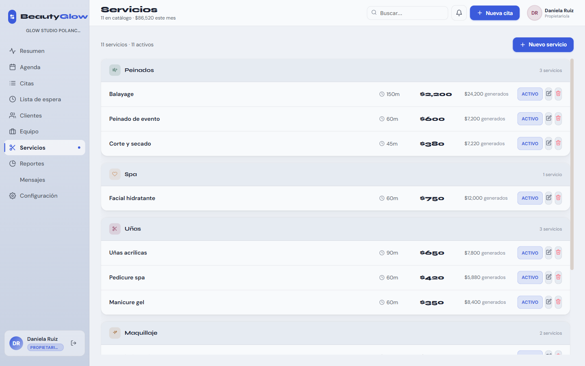
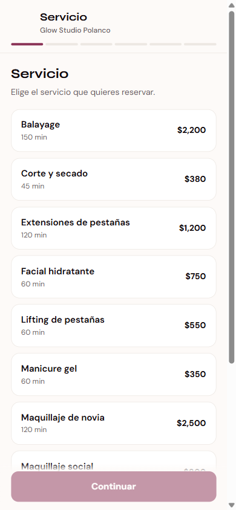
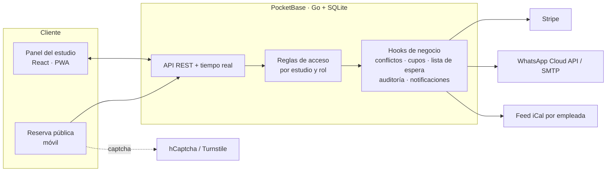

# BeautyGlow

**SaaS de agenda colaborativa y gestión para estudios de belleza** (uñas, maquillaje, peinados, pestañas y spa).
La dueña del estudio y su equipo administran citas, clientes, servicios y reportes desde un solo panel, y las clientas reservan desde una página pública.

> 🔒 **Producto comercial.** Este repositorio es un escaparate de portafolio: muestra el producto, sus funcionalidades y su arquitectura. El código fuente es privado.
> Todas las capturas usan un estudio y clientes **ficticios** creados para la demo.

---

## Funcionalidades

- **Multi-estudio con datos aislados**: cada estudio sólo accede a sus propios registros.
- **Cuentas personales y empresariales**: la empresarial incluye roles (dueña, administradora, empleada, sólo lectura), invitaciones por correo y permisos granulares.
- **Agenda** en vista día, semana y mes, con filtros por clienta y por integrante del equipo.
- **Validación en el servidor** de choques de horario, bloqueos de tiempo libre y límite de cupos por plan.
- **Lista de espera** que avisa automáticamente cuando se libera un espacio.
- **Reserva pública** para clientas, con captcha y política de cancelación configurable.
- **Reportes**: ingresos por día, mix de servicios, top servicios y clientas, exportación a Excel.
- **Recordatorios** por WhatsApp y correo.
- **Sincronización de calendario**: cada empleada ve las citas del estudio en su Google Calendar o iCal personal, sin mezclar datos.
- **Suscripciones** con Stripe, bitácora de auditoría y notificaciones.
- **PWA** instalable con modo offline e interfaz en español e inglés.
- **Onboarding** guiado para configurar especialidades, equipo y servicios.

## Capturas

| | |
|---|---|
|  |  |
| **Acceso** con correo o Google | **Onboarding** guiado del estudio |
|  |  |
| **Agenda semanal** por estado de cita | **Agenda del día** con equipo y precios |
|  |  |
| **Reportes** financieros y de operación | **Clientes** con visitas y gasto acumulado |
|  |  |
| **Catálogo de servicios** por categoría | **Reserva pública** desde el celular |

## Arquitectura

**Decisiones de diseño**

- **Lógica crítica en el servidor**: los choques de horario, los cupos del plan, la política de cancelación y los pagos se validan en el backend, no sólo en la interfaz.
- **Aislamiento por estudio**: cada registro pertenece a un estudio y las reglas de acceso impiden consultas entre estudios.
- **Integraciones intercambiables**: mensajería y captcha tienen un modo *mock* para desarrollo, y las credenciales sólo viven en variables de entorno.
- **Esquema versionado** con migraciones: 15 colecciones (estudios, usuarios, equipo, clientes, servicios, citas, lista de espera, bloqueos, invitaciones, notificaciones, mensajes, auditoría, facturación, entre otras).

## Stack

| Capa | Tecnología |
|---|---|
| Frontend | React 18, JavaScript, HTML/CSS con design system propio |
| Backend | PocketBase (Go + SQLite), hooks en JavaScript |
| Integraciones | Stripe, WhatsApp Cloud API, SMTP, hCaptcha / Cloudflare Turnstile, iCal |
| Plataforma | PWA (Service Worker, manifest), i18n es / en |

## Acceso al código

El código fuente no es público porque BeautyGlow es un producto de pago. Si eres reclutador o reclutadora y quieres revisarlo, escríbeme por [GitHub](https://github.com/ArmAlvR) y puedo hacer un recorrido en vivo o dar acceso temporal de sólo lectura.

---

© 2026 [@ArmAlvR](https://github.com/ArmAlvR). Todos los derechos reservados.
